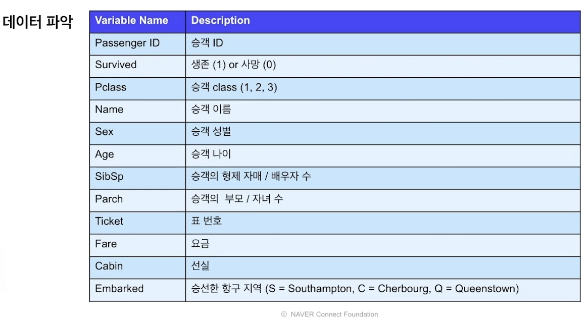

# EDA

수업일: 2024/04/23
주차: 1주차 학습내용

## 1. EDA

### 1.1 EDA 정의

**EDA(Exploratory Data Analysis, 탐색적 데이터 분석)**

**데이터를 탐색하고 가설을 세우고 증명하는 과정**

다양한 시각을 통해 데이터를 이해하고 특징을 찾아내는 과정

→ 이러한 특징들을 시각화, 통계량으로 표현

→ 데이터를 특징과 문제들을 직관적으로 이해

### 1.2 EDA 과정

**데이터를 탐색하고 가설을 세우고 증명하는 과정**

주어진 문제를 데이터를 통해 해결하기 위해 데이터를 이해하는 과정

→ 문제를 해결하는 과정에서 데이터에 대한 이해는 필수적임

→ 문제에 대한 이해와 데이터에 대한 이해를 통해 적절한 전처리, 방법론들을 선택

즉, 데이터를 통한 문제를 해결하기 위해 데이터를 이해하고 적절한 방법들을 적용

**탐색하고 생각하고 증명하는 과정의 반복**

1. Data에 대한 가설 혹은 의문
2. 시각화 혹은 통계량, 모델링을 통한 가설 검정
3. 위의 결론을 통해 다시 새로운 가설 혹은 문제 해결

데이터 마다 상이한 도메인

→ 데이터의 종류, 그리고 사용하게 되는 모델에 따라 EDA의 방향성은 그때 그때 다름

→ 금융, 제조, 보건 등 데이터는 고유의 도메인을 가짐

→ 일반화가 어렵고 정해진 답이 없음

EDA 시작

많은 가설 혹은 의문을 생각하고 풀어나가는 것이 좋다.

**→ 개별 변수의 분포 (Variation)**

**→ 변수간의 분포와 관계 (Covariation)**

---

## 2. EDA titanic data

### 2.1 데이터 파악

### 2.2 개별 변수

연속형 변수

Age → 20~40대가 가장 많고 10대가 좀 있는 쌍봉형태의 분포

SibSp, Parch, Fare → 왼쪽에 치우쳐진 포아송 분포

범주형 변수

### 2.3 변수간의 관계

target 변수와 같이 보기

여성 생존자가 더 많다. why ?

→ 아이와 여성을 먼저 탈출시키지 않았을까?

이름에서 결혼 유무를 찾아서 분석에 이용 

미혼여성보다 기혼여성의 경우 생존률이 높다. why?

→ 아이가 있을 확률이 높아 더 우선적으로 탈출시켰을까?

 

solo인 경우 생존률이 더 낮다. 

가족의 수라는 변수를 활용하여 대가족, 중가족, 싱글이라는 새로운 변수를 만들어 EDA

---

## 3. EDA our data

### 3.1 문제 이해 및 가설 세우기

문제이해

- Aggrgation ?
- Time Series ?
- Aggregation + Time Series ?

가설세우기 

- 이전 달의 total이 영향을 끼치지 않을까?
- 작년 12월 달의 total이 영향을 끼치지 않을까 ?
- 거주 국적에 따른 영향이 있을까?
- 고객마다 주로 구매하는 품목이 있을까? 그렇다면 target에 어떤 영향을 끼칠까?

### 3.2 가설검정 - 연속형

total 

가설 : 환불기록이 target에 영향을 줄까?

- -인 금액은 환불 금액일 것

특정 고객이 많은 구매 건수를 갖고 있음을 알 수 있음.

일정 trend 존재하는 것을 볼 수 있음.

연말에 올라가는 total sum

주기성도 존재

### 3.3 가설검정 - 범주형

영국 vs 다른 의외 국가 

→ 별 차이 없어 보임. 국가 변수는 따로 사용 안해도 될 것 같다.

---

## 4. Summary

EDA란

데이터를 이해하고 문제를 해결하는 과정에서 데이터를 통해 고민하는 모든 과정

데이터적 통찰력

데이터적 상상력