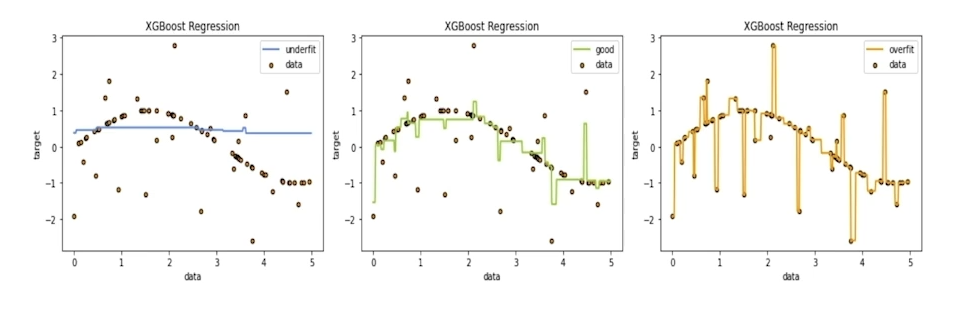

# 머신러닝 기본개념

수업일: 2024/04/25

## 1. Underfitting & Overfitting

### 1.1 What is Underfitting & Overfitting

- Underfitting : 데이터를 설명하지 못함
- Overfitting : 데이터를 과하게 설명함

### 1.2 How to monitoring Underfitting & Overfitting

전체 데이터셋을 잘 설명하는 sample 데이터셋을 추출하여 분석

### 1.3 Regularization

Overfitting을 방지하는 방법

- Early stopping
- Parameter norm penalty
- Data augmentation
- Noise robustness
- Label smotthing
- Dropout
- Batch normalization

정형 데이터에서도 사용 가능한 방법

**Early Stopping**

validation error가 지속적으로 증가하는 시점에서 중단하는 방법

trade-off 관계라고도 함. → 최적의 결과를 찾는 방

**Parameter norm penalty**

Noise에 민감하지 않게 model을 만들 수 있다.

파란색은 penalty를 준 경우. → 적절히 fit 됨.

초록색은 penalty를 주지 않은 경우 → overfitting 발생.

**Data augmentation**

원본 데이터를 확대, 축소, 회전 등을 진행하며 데이터의 개수를 늘리는 방법.

데이터를 의도적으로 증강시켜 모델에 다양한 경험을 줌. 의미 있는 데이터가 많을 수록 분석에 용이.

**SMOTE**

정형데이터를 증강시키는 방법. Imbalanced 데이터를 대상으로 주로 사용.

Imbalanced 데이터를 기준으로 설정하고 그 데이터를 바탕으로 근처의 데이터를 찾고 두개의 데이터의 중간 값을 데이터로 생성 

**Dropout**

딥러닝에서의 Dropout

ML에서는 가지치기

---

## 2. Validation strategy

### 2.1 What is validation strategy

Test 데이터는 최대한 full 데이터와 비슷하게 설정.

자주 바꾸는 것도 위험하다. validation 데이터를 바꾸는 것이 더욱 효과적인 전략.

validation 데이터의 목적

validation 데이터는 test 데이터와 최대한 유사하게 설정하는 것이 좋으나 Test 데이터를 볼 수 없는 경우도 있다. → 결국 전체 데이터셋과 비슷하게 설정하는 것이 중요.

### 2.2 Hold-out validation

하나의 validation 데이터를 고정하는 방식

하나의 train과 하나의 validation 데이터를 사용

class 비율을 고려하지 않으면 Inbalanced 데이터가 몰릴 수 있으니 주의해야한다.

validation 데이터를 구성하는 방식

Random하게 Train과 validation을 선택하는 방식

→ 전체 데이터셋을 대표하지 않을 수 있으니 다른 방식 고려

가장 많이 사용하는 방식으로 특정 값, 레이블 혹은 데이터의 카테고리컬 피쳐의 비율을 유지하며 데이터를 스플릿하는법. 

8:2, 9:1, 7:3 등 다양한 옵션 사용  

### 2.3 Cross validation

K-Fold 

train과 validation을 여러개로 구성하는 법

Stratified K-Fold

비율을 맞추며 K-Fold 하는 방식 → 분류 문제에서 많이 사용 

Group K-Fold

Group은 Fold 개수보다 커야 Group K-Fold Split이 가능하다.

Time series split

미래 데이터로 과거 데이터를 예측하는 일이 발생하지 않도록 사용

앞쪽 Fold일수록 train 데이터가 적다는 점을 감안해야 함.

---

## 3. Reproducibility

### 3.1 Fix seed

Random성을 제거하는 법.

---

## 4. Machine learning workflow

