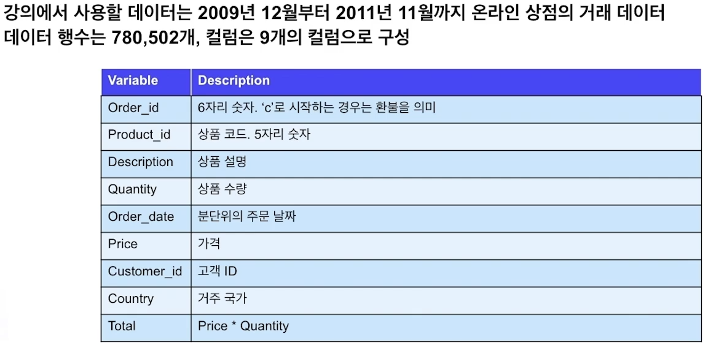

# 정형데이터란?

수업일: 2024/04/22
비고: 강의 정리
주차: 1주차 학습내용

## 1. 정형데이터

### 1.1 정형데이터의 정의

정형 데이터 : 엑셀 파일 형식이나 관계형 데이터베이스의 테이블에 담을 수 있는 데이터로 행(row)과 열(column)으로 표현 가능한 데이터.

하나의 행은 하나의 데이터 인스턴스를 나타내고, 각 열은 데이터의 피처를 나타냄.

비정형 데이터 : 이미지, 비디오, 음성, 자연어 등의 정제되지 않은 데이터

### 1.2 정형데이터의 중요성

떠오르는 비정형 데이터

이미지 → 자율주행자동차, 사물 인식 등

음성 → 음성 검색 서비스, 시리, 빅스비 등

자연어 → 번역, 이메일 필터 등 

→ 떠오르는 AI, 다양한 가치 창출

정형 데이터는 범용적인 데이터로 비즈니스 전체에 쓰이기 때문에 중요

사람, 기업, 현상, 사회의 많은 부분들이 정형데이터로 기록됨

→ 가장 기본적인 데이터

→ 분야를 막론하고 많은 데이터가 정형데이터로 존재. 필수적인 데이터

정형데이터의 분석 능력이란?

→ 데이터에 대한 상상력

→ 데이터에 대한 통찰력

다양한 경험을 통해 데이터에 국한 되지 않고 범용적으로 쓰일 수 있는 능력

데이터에 대한 이해가 가장 중요하다.

---

## 2. 데이터 및 문제 이해

### 2.1 데이터 이해

### 2.2 문제 이해

문제 정의 

X : 고객 5,914명의 2009년 12월 ~ 2011년 11월까지의 구매기록

Y : 고객 5,914명의 2011년 12월 총 구매액 300 초과 여부 (Binary)

타겟 마게팅, 고객 추천

→ 우량 고객들을 예측, 혜택의 개인화

valiadation 전략을 잘 짜야할 것

---

## 3. 평가지표 이해

### 3.1 분류, 회귀 평가지표 소개

분류(Classfication)

- 예측해야할 대상의 개수가 정해져 있는 문제
- 예) 이미지에서 개, 고양이 분류, 신용카드 거래가 사기 거래인지 정상 거래인지 분류 등

회귀(Regression)

- 예측해야할 대상이 연속적인 숫자인 문제
- 예) 일기 예보에서 내일의 기온 예측, 주어진 데이터에서 집값 예측

평가지표(Evaluation Metric)

- 분류, 회귀 머신러닝 문제의 성능을 평가할 지표
- 분류, 회귀에 따라 평가지표가 달라짐

### 3.2 Confusion Matrix

분류 문제에 이용

이진 분류의 예측 오류가 얼마인지 어떠한 예측 오류가 발생하고 있는지 보는 matrix

### 3.3 Accuracy

$$
Accuracy=(TP+TN)/(TP+TN+FP+FN)
$$

불균형한 데이터에는 부적합한 평가지표

### 3.4 Precision (정확도)

$$
Precison = TP/(TP+FP)
$$

대표적으로 스팸메일 분류. 스팸메일 몇개를 분류하지 못하더라도 정상메일을 오분류하지 않는다.

- Importance
    
    Negative > Positive
    

### 3.5 Recall (재현율)

$$
Recall = TP/(TP + FN)
$$

대표적으로 의학적인 데이터, 악성종양 분류 등

- Importance
    
    Positive > Negative
    

### 3.6 ROC AUC

$$
True Positive Ratio = TP/(TP+FN)
$$

$$
False Positive Ratio=FP/(FP+TN)
$$

→ TPR을 y축, FPR을 x축 바탕으로 Cutoff value

 

면적이 1에 가까울 수록 예측 잘하는 모델이며, 0에 가까울 수록 예측을 못하는 모델