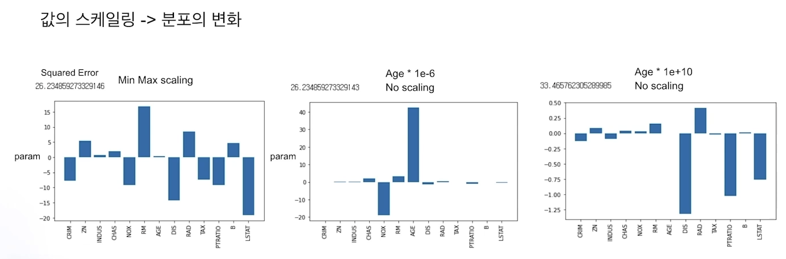

# 정형 데이터 전처리

수업일: 2024/04/24
주차: 1주차 학습내용

## 데이터 전처리(Preprocessing)?

머신러닝 모델에 데이터를 입력하기 위해 데이터를 처리하는 과정

→ EDA에 따라 달라지는 데이터 전처리

→ 모델, 목적에 따라 달라지는 데이터 전처리

- 연속형, 범주형 처리
- 결측치 처리
- 이상치 처리

Sklearn의 Boston Dataset

## 1. 연속형, 범주형 처리

### **1.1 continuous type**

Scaling

데이터의 단위 혹은 분포를 변경

- 선형기반의 모델(선형회귀, 딥러닝 등)인 경우 변수들 간의 스케일을 맞추는 것이 필수적

 **Scaling**

1. Min Max scaling 

$$
X_{new}= \frac{X_i-min(X)}{max(X)-min(X)}
$$

1. Standard Scaling

$$
x_{new} = \frac{x-\mu}{\sigma}
$$

1. Robust Scaling → 이상치의 영향을 덜 받는다.

$$
X_{scale} = \frac{x_i-x_{med}}{x_{75}-x_{25}}
$$

scaling에 따라 분포의 값도 변함 → 적절한 scaling 필요

**Scale + Distribution**

- Log transformation

왼쪽에 치우친 분포에 log transformation을 취하면 정규분포와 같은 형태를 만들 수 있다.

exponantial transformation의 경우 반대의 결과 초래

- Quantile transformation

어떠한 분포가 들어와도 Uniform or normal distribution으로 만들 수 있다.

LSTAT feature → Quantile transformation을 진행한 예시 

상관관계가 더 증가 

모델의 정확도를 높힐 수 있음.

기존 분포 → Quantile transformation

**Binning**

### 1.2 categorical type

**One hot encoding**

해당 값이 존재하면 1로, 존재하지 않으면 0으로 변환

모델이 변수의 의미를 정확히 파악한다는 장점을 가진다.

의미없는 숫자로 대체하는 방법

변수의 종이 많다면 모델의 성능이 좋아지지 않다. Memory 측면

**Label encoding**

column의 개수를 늘리지 않고, 각각의 값에 값을 부여.

모델이 숫자의 순서를 특징으로 인식할 수 있다는 단점을 가진다.

의미없는 숫자로 대체하는 방법

선형 모델의 경우 범주형 변수의 값이 순서를 가지고 있고 이를 순서에 맞게 Label Encoding을 했다면 사용할 수 있지만, 그렇지 않은 경우 사용할 수 없다.

**Frequency encoding**

해당 변수의 값이 몇번 나오는지 빈도수를 값으로 사용하는 방법

의미있는 값을 모델에 영향을 줄 수있는 장점을 가진다.

값의 의미가 범주형 변수의 빈도수가 얼마나 되는지를 나타낸다.

**Target encoding**

종들의 target의 평균으로 encoding

하나의 column을 유지하고 순서에 영향을 받지않는 장점을 가진다. 

의미있는 값을 모델에 영향을 줄 수있는 장점을 가진다.

종은 다르지만 encoding 값이 같아져 겹치는 경우가 존재할 수 있다.

값의 의미가 target 변수와 얼마나 관련되어 있는지를 나타낸다.

→ Overfitting 발생 가능. 적절한 조치 필요

**Embedding encoding**

---

## 2. 결측치 처리

### 2.1 pattern

x축은 변수, y축은 순서대로 정렬했을 때 결측치

결측치가 Random의 형태를 띄고 있는지, 어떤 Rule or Pattern을 갖고 존재하는지 우선적으로 파악.

pattern이 존재하지 않음. 단변량(Univariate) 혹은 다변량(Multivariate)으로 결측치 처리를 진행해야한다.

pattern 존재. 데이터를 직접 확인할 필요 있음.

A3, A4, A6에 결측치 존재하면 A5, A2에도 결측치가 존재하는 것을 확인 가능

결측치를 제외한 모든 값이 같기 때문에 같은 값으로 결측치 처리

### 2.2 univariate

- 제거
    - 결측치가 있는 datapoint 제거
        
        데이터가 충분히 존재하지 않으면 적절하지 않음.
        
    - 결측치가 존재하는 변수 제거
        
        결측치의 비율이 많다면 모델에 좋은 영향 X → 제거가 더 적절하다.
        
- 평균값 삽입
- 중위값 삽입
- 상수값 삽입
    
    → 문제점 ?
    

분포가 망가질 수 있다.

x축은 변수, y축은 target과의 상관관

결측치의 비율에 따라 발생할 수 있는 문제점

파란색은 결측치를 채우기 전 상관관계. 주황색은 결측치를 채운 후의 상관관계

결측치의 비율이 클 경우 평균과 같은 값으로 채울 경우 상관관계가 많이 낮아짐.

### 2.3 multivariate

Model을 통해 결측치를 채울 수도 있다.

채워야하는 결측치의 수가 많다면 힘들 수 있음.

데이터의 분포, 상관관계가 유지되고 있음.

---

## 3. 이상치 처리

### 3.1 이상치란

### 3.2 이상치 탐색

- Z-Score
- IQR

### 3.3 이상치 처리 관점

- 정성적인 측면
    - 이상치 발생 이유
    - 이상치의 의미

x축은 아파트가 지어진 연도, y축은 아파트 가격

1970년대에 지어졌지만 아파트 가격이 높은 이상치 

→ 재개발 혹은 재건축이 이유이지 않을까? 

→ 재개발 여부와 같은 새로운 변수를 넣어줌으로써 이상치 처리 가능

- 성능적인 측면
    - Train Test Distribution

파란색은 Training data, 노란색은 Test data, 빨간색은 Z-Score 방식으로 탐색한 이상치 data

이상치와 Training data의 분포는 조금 겹치지만, Test data와는 겹치지 않음

→ 이상치 제거함으로서 성능이 향상됨.