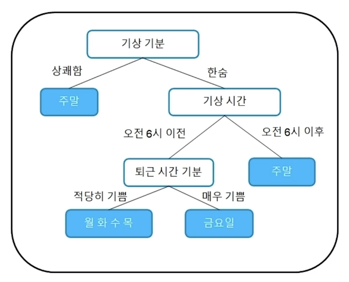

# 트리모델

수업일: 2024/04/26
주차: 1주차 학습내용

## 1. What is tree model

### 1.1 트리 모델의 기초 의사결정나무

Decision Tree

- 칼럼(feature) 값들을 어떠한 기준으로 group을 나누어 목적에 맞는 의사결정을 만드는 방법
- 하나의 질문으로 yes or no로 decision을 내려서 분류

### 1.2 트리 모델의 발전

### 1.3 Bagging & Boosting

Bagging과 Boosting의 차이점은 train 데이터를 어떻게 활용하느냐에 가장 큰 차이점이 있다.

**Bagging**

- 데이터 셋을 샘플링하여 모델을 만들어 나가는 것이 특징
- 샘플링한 데이터 셋을 하나로 하나의 Decision Tree가 생성
- 생성한 Decision Tree의 Decision들을 취합(aggregation)하여 하나의 Decision 생성

Bagging = Bootstrap + Aggregation

Boostrap : Data를 여러번 sampling

Aggregation : 종합(Ensemble)

**Decision tree**

모든 데이터를 사용하여 tree를 생성

일련의 분류 기준을 설명한 뒤 분류예측하여 규칙을 찾는 알고리즘

**Bagging**

하얀색 데이터들은 tree를 만들 때 사용되지 않은 데이터

하나의 데이터셋에서 여러번 샘플링을 진행하여 다양한 데이터셋을 만들어 이를 기반으 tree를 만들어내는 방식

**Boosting**

초기에 random하게 선택된 데이터셋을 이용하여 tree를 만들고 잘 맞추지 못한 데이터에 weight을 부여하여 다음 tree를 만들 때 영향을 주고 잘 맞출 수 있도록 한다.

크기가 커진 데이터가 weight을 의미

|  | Bagging | Boosting |
| --- | --- | --- |
| Tree 생성 방법 | 병렬 모델
(각 모델이 서로 연관이 없음) | 순차적 모델
(이전 Tree의 오류 기반으로) |
| 특징 | 다양한 Tree 생성 | 정밀한 Tree 생성 |

### 1.4 LightGBM, XGBoost, CatBoost

XGBoost와 CatBoost는 양쪽에 균형적으로 tree를 생성

LightGBM의 경우 한 쪽의 tree를 생성한 뒤, 반대 쪽 tree 생성

---

## 2. Tree model with hyper-parameter

### 2.1 hyper-parameter 살펴보기

**learning rate**

왼쪽 그림과 같이 learning rate를 적게 하면 수렴 속도가 낮아진다.

오른쪽 그림과 같이 learning rate를 크게 하면 수렴이 아닌 발산을 할 수 있다.

적당한 learning rate를 설정하는 것이 중요.

**Tree depth and number of leaves**

모델의 깊이와 잎사귀의 수를 제한할 수 있다.

tree를 너무 깊게 만들거나 잎사귀를 제한없이 사용한다면 overfitting 발생 가능

**Column sampling ratio**

파란색은 tree 생성에 선택된 feature, 회색은 선택되지 않은 feature

전체 feature중 random하게 일부분만 선택하여 tree 생성 

→ 특정 feature에 overfitting 되는 것을 방지할 수 있다.

계속 random하게 feature 선택 후 tree 생성 →  overfitting 방지 가능

**Row sampling ratio**

파란색은 tree 생성에 선택된 row, 회색은 선택되지 않은 row

Column sampling ratio와 동일하게 진행.

| parameter | XGBoost | CatBoost | LightGBM |
| --- | --- | --- | --- |
| Learning rate | learning_rate | learning_rate | learning_rate |
| Tree depth | max_depth | depth | max_depth |
| Number of leaves | max_leaves | max_leaves | num_leaves |
| Number of tree | n_estimators | n_estimators | n_estimators |
| Early stop | early_stopping_rounds | od_wait | early_stopping_rounds |
| Row sampling ratio | subsample | subsample | bagging_freq |
| Column sapling ratio | colsample_bytree | rsm | colsample_bytree |
| L1 / L2 norm penalty | alpha / lambda | l2_leaf_reg | lambda_l1 / lambda_l2 |

### 2.2 hyper-parameter 실습

Category 변수 다루기

- LightGBM과 CatBoost는 pandas의 category 데이터 타입 가능
- XGBoost는 오직 numeric 데이터 타입만 가능

| model | XGBoost | CatBoost | LightGBM |
| --- | --- | --- | --- |
| data type | numeric | category | category |

1. pandas를 통해 data를 불러오면 category 변수가 object 변수로 저장되어 있음. → category 타입으로 변환해주는 과정 필요 
2. LightGBM에 넣는 코드
3. CatBoost에 넣으면 error 발생
4. cat_features = [] 를 통해 인덱스를 명시해주면 정상 작동

label encoding 방식을 통해 category 변수를 numeric 변수로 변

depth를 조절하면 더 보기 쉬운 tree 구조 확인 가능

현재 dataset으로 model을 돌려봤을 때 성능

CatBoost → LightGBM → XGBoost

CatBoost와 LightGBM은 category 변수를 활용하여 model을 진행하기에 성능이 좋은 것으로 유추

XGBoost도 label encoding 보다 더 좋은 encoding 방법을 활용한다면 더 좋은 성능 나올 것으로 기대

### 2.3 Baseline code (tree model train) 살펴보기

---

## 3. Baseline code(tree model train) 살펴보기