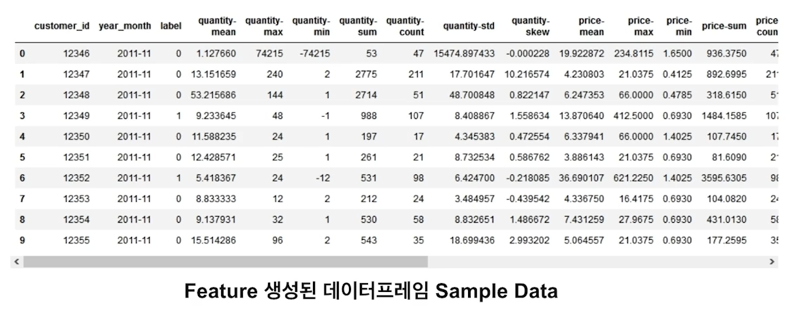

# 피처 엔지니어링

수업일: 2024/04/29 → 2024/04/30
주차: 2주차 학습내용

## 1. 피처 엔지니어링 (1)

**Feature Enginnering**

: 원본 데이터로부터 도메인 지식 등을 바탕으로 문제를 해결하는데 도움이 되는 Feature를 생성, 변환하고 이를 머신 러닝 모델에 적합한 형식으로 변환하는 작업

### 1. Pandas Group By Aggregation을 이용한 Feature Engineering
**Feature Enginnering**

: 원본 데이터로부터 도메인 지식 등을 바탕으로 문제를 해결하는데 도움이 되는 Feature를 생성, 변환하고 이를 머신 러닝 모델에 적합한 형식으로 변환하는 작업

### 1. Pandas Group By Aggregation을 이용한 Feature Engineering

고객의 구매 거래 데이터에서 고객이 구매할지 여부를 예측해야함 → 고객이 기준이기 때문에 고객 ID 기반으로 Group By Aggregation




과거 고객 구매액의 총 합을 의미


과거 고객이 구매 상품 개수의 합을 의미


과거 고객이 주문한 상품 가격의 합을 의미


과거 고객이 주문한 구매액의 개수를 의미


과거 고객이 주문한 상품 개수의 건수를 의미


과거 고객이 주문한 상품 가격의 개수를 의미

total - count, quantity-count, price-count 모두 동일한 값을 갖고 있다. 

→ count이기때문에 row수를 세기 때문이다. 

**feature별 label 분포가 다르기 때문에 사용 GOOD**

---


과거 고객이 주문한 구매액의 평균을 의미


과거 고객이 주문한 상품 개수의 평균을 의미 


과거 고객이 주문한 상품 가격의 평균을 의미


과거 고객이 주문한 상품 구매액의 최솟값을 의미


과거 고객이 주문한 상품 개수의 최솟값을 의미

→ 값이 음수인 값은 환불건

→ 환불 값이 클수록 원래 구매액이 클테니 다음과 같은 분포를 보이는 것으로 예상.


과거 고객이 주문한 상품 가격의 최솟값을 의미

→ 상품가격은 음수인 값은 없음

→ 특이점으로는 label=1인 경우의 값이 label=0인 경우보다 값이 더 적은 것을 알 수 있음.

---


과거 고객이 주문한 구매액의 최댓값을 의미


과거 고객이 주문한 상품개수의 최댓값을 의미


과거 고객이 주문한 상품가격의 최댓값을 의미


과거 고객이 주문한 구매액의 표준편차를 의미


과거 고객이 주문한 상품 개수의 표준편차를 의미


과거 고객이 주문한 상품가격의 표준편차


과거 고객이 주문한 구매액의 값이 어느쪽으로 쏠려있는지를 의미


과거 고객이 주문한 상품 개수의 값이 어느쪽으로 쏠려있는지를 의미


과거 고객이 주문한 상품가격의 값이 어느쪽으로 쏠려있는지를 의미

→ skew값이 0보다 크면 왼쪽으로 쏠려있고, 0보다 작으면 오른쪽으로 쏠려있음.

→ skew값이 큰 것이 label=1이 될 확률이 더 높아보임.

**feature별 label 분포가 다르기 때문에 사용 SOSO**

---


### 2. Cross Validation을 이용한 Out Of Fold 

모델 Training시 Cross Validation을 적용해서 Out of Fold Validation 성능 측정 및 Test 데이터 예측을 통해 성능 향상


```python
folds = 5 # 5 folds
model_params = ... # lightgbm hyperparameter
x_train = ... # train data
x_test = ... # test data
y = ... # train label

# validation out of fold 예측값을 저장할 변수
y_oof = np.zeros(x_train.shape[0]) # -> train 개수만큼 선언
# test data 예측값을 저장할 변수
y_preds = np.zeros(x_test.shape[0]) # -> test 개수만큼 선언

skf = StratifiedKFold(n_splits = folds , shuffle = True, random_state = 42)
# stratified k fold split 함수로 train index, validation index를 가져옴
for fold, (tr_idx, val_idx) in enumerate(skf.split(x_train, y)) :
	# train, validation index로 train data split
	# for in enumerate 구문은 반복 작업을 하면서 해당 요소의 인덱스가 필요한 경우에 유용.
	x_tr, x_val = x_train.loc[tr_idx], x_train.loc[val_idx]
	y_tr, y_val = y[tr_idx], y[val_idx]
	dtrain = lgb.Dataset(x_tr, label = y_tr)
	dvalid = lgb.Dataset(x_val, label = y_val)
	
	# lightgbm 모델 train
	clf = lgb.train(model_params, dtrain, valid_sets = [dtrain, dvalid])
	
	# out of fold validation data 예측
	y_oof[val_idx] = clf.predict(x_val)
	
	# train된 모델로 test data 예측
	y_preds += clf.predict(x_test) / foldss
	
# 전체 fold loop 순회 후 out of fold validation 성능 측정
print(f"OOF AUC = {roc_auc_score(y, y_oof)}")
```

### 3. LightGBM Early Stopping 적용

LightGBM에서 제공하는 Early Stopping을 적용해서 성능 향상

**Early Stopping이란?**

- Iteration을 통해 반복학습이 가능한 머신러닝 모델에서 validation 성능 측정을 통해 validation 성능이 가장 좋은 하이퍼파라미터에서 학습을 조기 종료하는 Regularization 방법
- 예) Boosting 트리 모델 트리 개수, 딥러닝의 Epoch 수

**LightGBM Early Stopping**

- LightGBM에서 몇 개의 트리를 만들지 n_estimators란 하이퍼파라미터로 설정하고 이 개수만큼 트리를 만들지만, 설정한 트리 개수가 최적의 값이라고 볼 수 없음
- Early Stopping은 validation 데이터가 있을 시, LightGBM 트리 개수인 n_estimators는 충분히 크게 설정하고, early_stopping_rounds를 적절한 값으로 설정
- 트리를 추가할 때마다 validation 성능을 측정하고 이 성능이 early_stopping_rounds 값 이상 연속으로 성능이 좋아지지 않으면 더 이상 트리를 들지 않고 가장 validation 성능이 좋은 트리 개수를 최종 트리 개수로 사용

```python
folds = 5 # 5 folds
model_params = {**'n_estimators': 10000**, ... }# lightgbm hyperparameter
x_train = ... # train data
x_test = ... # test data
y = ... # train label

# validation out of fold 예측값을 저장할 변수
y_oof = np.zeros(x_train.shape[0]) # -> train 개수만큼 선언
# test data 예측값을 저장할 변수
y_preds = np.zeros(x_test.shape[0]) # -> test 개수만큼 선언

skf = StratifiedKFold(n_splits = folds , shuffle = True, random_state = 42)
# stratified k fold split 함수로 train index, validation index를 가져옴
for fold, (tr_idx, val_idx) in enumerate(skf.split(x_train, y)) :
	# train, validation index로 train data split
	# for in enumerate 구문은 반복 작업을 하면서 해당 요소의 인덱스가 필요한 경우에 유용.
	x_tr, x_val = x_train.loc[tr_idx], x_train.loc[val_idx]
	y_tr, y_val = y[tr_idx], y[val_idx]
	dtrain = lgb.Dataset(x_tr, label = y_tr)
	dvalid = lgb.Dataset(x_val, label = y_val)
	
	# lightgbm 모델 train
	clf = lgb.train(model_params, dtrain, valid_sets = [dtrain, dvalid]
									**, early_stopping_rounds = 100)** 
									# 100round 이상 validation 성능이 좋아지지 않으면 training 멈춤
									****# 가장 validation 성능이 좋은 tree 개수를 최종 tree 개수로 설정	
	# out of fold validation data 예측
	y_oof[val_idx] = clf.predict(x_val)
	
	# train된 모델로 test data 예측
	y_preds += clf.predict(x_test) / foldss
	
# 전체 fold loop 순회 후 out of fold validation 성능 측정
print(f"OOF AUC = {roc_auc_score(y, y_oof)}")
```

---
## 2. 피처 엔지니어링 (2)

---

## 3. 피처 중요도와 피처 선택

---

## 4. 피처 엔지니어링 연습