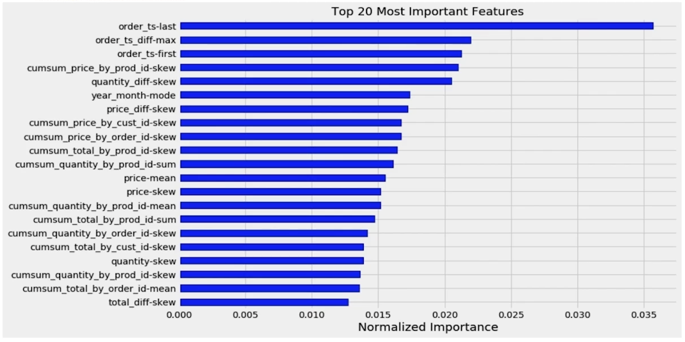

# 피처 중요도와 피처 선택

수업일: 2024/05/01
비고: 강의 정리
주차: 2주차 학습내용

## 1. 피처 중요도란?

- 피처 중요도
    - 타겟 변수를 예측하는데 얼마나 유용한 지에 따라 피처에 점수를 할당해서 중요도를 측정하는 방법
- Model-specific vs Model-agnostic
    - 머신러닝 모델 자체에서 피처 중요도 계산이 가능하다면 Model-specific
    - 모델에서 제공하는 기능에 의존하지 않고 모델을 학습한 후에 적용되는 피처 중요도 계산 방법은 Model-agnostic

---

## 2. Boosting Tree 피처 중요도

Model-Specific Method

- LightGBM 피처 중요도
    - Training된 LightGBM 모델 클래스에 feature_importance(importance_type) 함수로 피처 중요도 계산 기능 제공
    - 인자의 importance_type 값에 ‘split’ 또는 ‘gain’ 사용 가능, default는 ‘split’
        - split : numbers of times the feature is used in a model
        - gain : total gains of splits which use the feature

LightGBM FeatureImportance

- XGBoost 피처 중요도 함수
    - Training된 XGBoost 모델 클래스에 get_score(importance_type) 함수로 피처 중요도 계산 기능 제공
    - 인자의 importance_type, default는 ‘weight’
        - ‘weight’ : the number of times a feature is used to split the data across all trees.
            
            LightGBM의 split과 유사
            
        - ‘gain’ : the average gain across all splits the fature is used in.
            
            LightGBM의 gain과 유사
            
        - ‘cover’ : the average coverage across all splits the feature is used in.
        - ‘total_gain’ : the total gain across all splits the feature is used in.
        - ‘total_cover’ : the total coverage across all splits the feature is used in.

XGBoost FeatureImportance

Model의 특성에 따라 feature 계산 방법이 다르기 때문에 다른 feature가 나온다.

- CatBoost 피처 중요도 함수
    - Training된 CatBoost 모델 클래스에 get_feature_importance(type) 함수로 피처 중요도 계산 기능 제공
    - 인자의 type, default는 FeatureImportance
        - FeatureImportance : Equal to PredictionValuesChange for non-ranking metrics and LossFunctionChange for ranking metrics
        - ShapValues : A vector with contributions of each feature to the prediction for every input object and the expected value of the moel prediction for the object
        - Interaction : The value of the feature interaction strength for each pair of features.
        - PredictionDiff : A vector with contributions of each feature to the RawFormulaVal difference for each pair of objects.

CatBoost FeatureImportance

---

## 3. Permutation 피처 중요도

- Measure the importance of a feature by calculating the increase in the model’s prediction error after peruting the feature.
- A feature is “important" if shuffling its values increases the model error, because in this case the model reied on the feature for the prediction.
- A feature is “unimportant” if shuffling its values leaves the model error unchanged, because in this case the model ignored the feature for the prediction.

→ feature에 있는 값들을 random하게 shuffling 한 후, model의 error를 측정해 그 feature가 중요하다면 값들을 섞으면 model의 error가 커질 것. 

→ feature가 중요하지 않다면 random shuffling해도 중요하지 않기에 error가 커지지 않을 것.

permutation feature importance sudo code

permutation feature importance 

---

## 4. 피처 선택(Feature Selection)이란?

- 피처 선택
    - 머신러닝 모델에서 사용할 피처를 선택하는 과정
    - 머신러닝 모델이 타겟 변수를 예측하는데 유용한 피처와 유용하지 않은 피처를 구분해서 유요한 피처를 선택하는 과정
    - 피처 선택을 통해 모델의 복잡도를 낮춤으로써 오버피팅 방지 및 모델의 속도 향상 가능
    - 피처선택 방법
        - Filter Method
        - Wrapper Method
        - Embedded Method

**Filter Method**

Filter type methods select variables regardless of the model. They are based only on general features like the correlation with the variable to predict. Filter methods suppress the least interesting variables. The other variables will be part of a classfication or a regression model used to classify or to predict data. These methods are particularly effective in computation time and robust to overfitting.

통계적인 기법을 이용하여 Feature간의 상관관계를 따짐. → 모델에 가장 적합한 방법은 아님

- 계산 속도가 빠르다.
- Feature간 상관관계를 알아내기에 적합 → Wrapper Method 사용전 전처리 용도로 주로 사용.
1. Correlation이 높은 feature 제거.
2. feature의 variance가 작은 값을 제거. (variance가 x값 이상인 feature들 사용)

**Wrapper Method**

Wrapper methods evalutate subsets of variables which allows, unlike filter approaches, to detect the possible interactions amongst variables. The two main disadvantages of these methods are : 

- The increasing overfitting risk when the number of observations is insufficient.
- The significant computation time when the number of variables is large.

예측 모델을 활용하여 feature의 subset을 계속 test

hold-out  data set을 따로 두어서 validation 성능을 측정할 수 있는 방법이 필요.

**Embedded Method**

Embedded methods have been recently proposed that try to combine the advantages of both previous method. A learning algorithm takes advantage of its own variable selection process and performs feature selection and classification simultaneously.

학습 알고리즘 자체에 feature selection 기능이 탑재되어있는 방식.