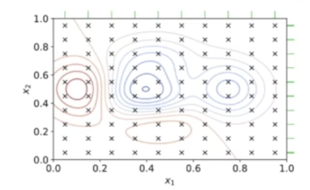

# 하이퍼파라미터 튜닝

수업일: 2024/05/02
비고: 강의 정리
주차: 2주차 학습내용

## 1. 하이퍼 파라미터(Hyper Parameter) 튜닝이란?

- Hyper Parameter
    - A hyperparameter is a parameter whose value is used to control the learning process. By contrast, the values of other parameter (typically node weights) are learned.
    - 모델이 학습하기 전에 미리 설정해줘야함.
- Hyper Parameter tunning
    - Choosing a set of optimal hyperparameters for a learning algorithm

**Hyper parameter tunning method**

1. Manual Ssearch : 자동화 툴을 사용하지 않고 매뉴얼하게 실험할 하이퍼 파라미터 셋을 정하고 하나씩 바꿔가면서 테스트 해보는 방식

1. Grid Search
    
    The traditional way of performing hyperparameter optimization has been grid search, or a parameter sweep, which is simply an exhaustive searching through a manually specified subset of the hyperparameter space of a learning algorithm. A grid search algorithm must be guided by some performance metric, typically measured by cross-validation on the training set or evaluation on a held-out validation set
    
    
    
    가능한 조합을 모두 다 test해보는 방식.
    
    parameter 수가 많다면 효율적이지 않다.
    
2. Random Search
    
    Random Search replaces the exhaustive enumeration of all combinations by selecting them randomly. This can be simply applied to the discrete setting described above, but also generalizes to continuous and mixed spaces. It can outperform Grid search, especially when only a small number of hyperparameters affects the final performance of the machin learning algorithm.
    
    
    
    탐색 가능한 hyperparameter 영역에서 random하게 값을 가져와서 test 해보는 방식
    
    Grid Search보다 일반적으로 더 효율이 잘 나온다.
    
3. Bayesian optimization
    
    A global optimization method for noisy black-box functions. Applied to hyperparameter optimization, Bayesian optimization builds a probabilistic model of the function mapping from hyperparameter values to the objective evaluated on a validation set. It tries to balance exploration (hyperparameters for which the outcome is most uncertain) and exploitation (hyperparameters expected close to the optimum).
    
    
    
    요즘 많이 제공하는 방식. 기존 방식보다 효율적임.
    
    처음에 random하게 값을 가져와서 test하다가 이전에 성능이 잘 나온 영역들을 바탕으로 집중적으로 탐색해서 최적의 hyperparameter를 찾는다.
    

---

## 2. Boosting Tree Hyper Parameter

| parameter | XGBoost | CatBoost | LightGBM |
| --- | --- | --- | --- |
| Learning rate | learning_rate | learning_rate | learning_rate |
| Tree depth | max_depth | depth | max_depth |
| Number of leaves | max_leaves | max_leaves | num_leaves |
| Number of tree | n_estimators | n_estimators | n_estimators |
| Early stop | early_stopping_rounds | od_wait | early_stopping_rounds |
| Row sampling ratio | subsample | subsample | bagging_freq |
| Column sapling ratio | colsample_bytree | rsm | colsample_bytree |
| L1 / L2 norm penalty | alpha / lambda | l2_leaf_reg | lambda_l1 / lambda_l2 |

---

## 3. Optuna 소개

- 오픈소스 하이퍼 파라미터 튜닝 프레임워크
    - 주요 기능
        - Eager search spaces
            - Automated search for optimal hyperparameters usin Python conditionals, loops, and syntax
        - State-of-the-art algorithms
            - Efficiently search large spaces and prune unpromising trials for faster results
        - Easy parallelization
            - Parallelize hyperparameter searches over multiple threads or processes without modifying code

### Optuna 기본 개념

최적화 할 objective function 정의

A simple optimization problem:

1. Define objective function to be optimized. Let’s minimize (x-2)^2
2. Suggest hyperparameter values usin trial object. Here, a float value of x is suggested from -10 to 10
3. Create a study object and invoke the optimize method over 100 trials

```python
import optuna

def objective(trial):
	x = trial.suggest_uniform('x'. -10, 10)
	return (x-2) ** 2
	
study = optuna.create_study()
study.optimize(objective, n_trials = 100)

study.best_params # E.g. {'x': 2.002108042}
```

### Optuna LightGBM 적용

```python
import lightgbm as lgb

import optuna 

# 1. Define on objective function to be maximized.
def objective(trial):
	...
	
	# 2. Suggest values of the hyperparameters using a trial object.
	param = {
		'objective' : 'binary',
		'metric' : 'binary_logloss', 
		'verbosity' : -1,
		'boosting_type' : 'gdbt',
		'lambda_l1' : trial.suggest_loguniform('lambda_l1', 1e-8, 10.0),
		'lambda_l2' : trial.suggest_loguniform('lambda_l2', 1e-8, 10.0),
		'num_leaves' : trial.suggest_loguniform('num_leaves', 2, 256),
		'feature_fraction' : trial.suggest_loguniform('feature_fraction', 0.4, 1.0),
		'bagging_fraction' : trial.suggest_loguniform('bagging_fraction', 0.4, 1.0),
		'bagging_fraq' : trial.suggest_int('bagging_freq', 1, 7),
		'min_child_samples' : trail.suggest_int('min_child_samples', 5, 100),
	}

	gbm = lgb.train(param, dtrain)
	...
	return accuracy
	
# 3. Create a study object and optimize the objective function.
study = optuna.create_study(direction='maximize') # accuracy는 높으면 좋기 때문에 maximize
study.optimize(objective, n_trials=100)
```

### Optuna Hyper Parameter 탐색 결과 저장

- Storage API를 사용해서 하이퍼 파라미터 검색 결과 저장 가능
- RDB, Redis와 같은 Persistent 저장소에 하이퍼 파라미터 탐색 결과를 저장함으로써 한 번 탐색하고, 다음에 다시 이어서 탐색 가능

```python
import optuna

def objective(trial):
	x = trial.suggest_float('x', -100, 100)
	return x ** 2
	
storage = optuna.storages.RDBStorage(
	url='sqlite:///:memory',
	engine_kwargs={'pool_size': 20, 'connect_args': {'timeout': 10}},
)

study = optuna.create_study(storage=storage)
study.optimize(objective, n_trials=10)
```

### Optuna Hyper Parameter Visualization

```python
import optuna

def objective(trial):
	x = trial.suggest_int('x', 0, 2)
	y = trial.suggest_float('y', -1.0, 1.0)
	z = trial.suggest_float('z', 0.0, 1.5)
	return x ** 2 + y ** 3 - z ** 4
	
sampler = optuna.samplers.RandomSampler(seed=10)
study = optuna.create_study(sampler=sampler)
study.optimize(objective, n_trials=100)

fig = optuna.visualization.plot_param_importances(study)
fig.show()	

```


Hyperparameter Importance

Hyperparameter History Visualization

```python
import optuna 

def objective(trial):
	x = trial.suggest_foat('x', -100, 100)
	y = trial.suggest_categoriacl('y', [-1 ,0, 1])
	return x ** 2 + y
	
sampler = optuna.samplers.TPESampler(seed=10)
study = optuna.create_study(sampler=sampler)
study.optimize(objective, n_trials=10)

fig = optuna.visualization.plot_optimization_history(study)
fig.show()
```


낮을 수록 모델의 성능이 좋다.

Hyperparameter Slice Visualization

```python
import optuna 

def objective(trial):
	x = trial.suggest_foat('x', -100, 100)
	y = trial.suggest_categoriacl('y', [-1 ,0, 1])
	return x ** 2 + y
	
sampler = optuna.samplers.TPESampler(seed=10)
study = optuna.create_study(sampler=sampler)
study.optimize(objective, n_trials=10)

fig = optuna.visualization.plot_slice(study, params=['x', 'y'])
fig.show()
```


각 hyperparameter별로 목적함수 값이 어떻게 변하는지를 보여줌.

Hyperparameter Contour Visualization

```python
import optuna 

def objective(trial):
	x = trial.suggest_foat('x', -100, 100)
	y = trial.suggest_categoriacl('y', [-1 ,0, 1])
	return x ** 2 + y
	
sampler = optuna.samplers.TPESampler(seed=10)
study = optuna.create_study(sampler=sampler)
study.optimize(objective, n_trials=30)

fig = optuna.visualization.plot_contour(study, params=['x', 'y'])
fig.show()
```


 Hyperparameter Parallel Coordinate Visualization

```python
import optuna 

def objective(trial):
	x = trial.suggest_foat('x', -100, 100)
	y = trial.suggest_categoriacl('y', [-1 ,0, 1])
	return x ** 2 + y
	
sampler = optuna.samplers.TPESampler(seed=10)
study = optuna.create_study(sampler=sampler)
study.optimize(objective, n_trials=10)

fig = optuna.visualization.plot_coordinate(study, params=['x', 'y'])
fig.show()
```

