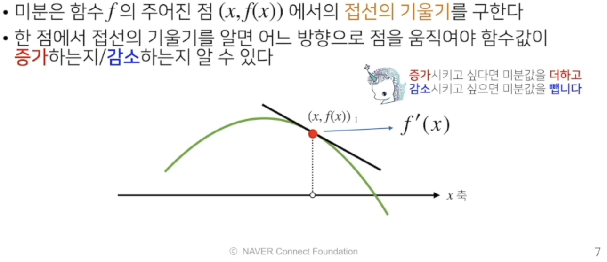

# 경사하강법

수업일: 2024/05/18
비고: 강의 정리
주차: 4주차 학습내용

미분(differentitaion)은 변수의 움직임에 따른 함수값의 변화를 측정하기 위한 도구로 최적화에서 제일 많이 사용하는 기법

$$
f'(x) = \lim_{h\to0}\frac{f(x+h)-f(x)}{h}
$$

```python
import sympy as sym
from sympy.abc import x

sym.diff(sym.poly(x**2 + 2*x + 3), x)
```




경사상승/경사하강 방법은 극값에 도달하면 움직임을 멈춘다.

경사하강법 : 알고리즘

```python
Input : gradient, init, lr, eps, Output : var
----------------------------------------------
# gradient : 미분을 계산하는 함수
# init: 시작점, lr: 학습률, eps: 알고리즘 종료조건
# 컴퓨터로 계산시 미분값이 정확히 0이 되는것은 불가능하므로 종료 조건 필요

var = init
grad = gradient(var)
while(abs(grad) > eps): 
		var = var - lr * grad
		grad = gradient(var)
```

```python
def func(val):
	fun = sym.poly(x**2 + 2*x + 3)
	return fun.subs(x,val), fun
	
def func_gradient(fun, val):
	_, function = fun(val)
	diff = sym.diff(function, x)
	return diff.subs(x, val), diff
	
def gradient_descent(fun, init_point, lr_rate=1e-2, epsilon=1e-5):
	cnt = 0
	val = init_point
	diff, _ = func_gradient(fun, init_point)
	while np.abs(diff) > epsilon:
		val = val - lr_rate*diff
		diff, _ = func_gradient(fun, val)
		cnt += 1
		
	print('함수 {}, 연산횟수: {}, 최소점: ({}, {})'.format(fun(val)[1], cnt, val, fun(val)[0]))
	
	gradient_descent(fun=func, init_point = np.random(uniform(-2, 2))
```

변수가 벡터인 경우

- 미분은 변수의 움직임에 따른 함수값의 변화를 측정하기 위한 도구로 최적화에서 제일 많이 사용하는 기법
- 벡터가 입력이 다변수 함수의 경우 편미분(partial differentiation)을 사용한다

$$
\partial_{x_i}f(x) = \lim_{h\to0}\frac{f(x+he_i)-f(x)}{h}
$$

$$
f(x,y) = x^2+2xy+3+cos(x+2y)
$$

$$
\partial_xf(x,y) = 2x+2y-sin(x+2y)
$$

```python
import sympy as sym
from sympy.abc import x, y

sym.diff(sym.plot(x**2 + 2*x*y + 3) + sym.cos(x+2*y), x)
```

- 각 변수 별로 편미분을 계산한 그레디언트 벡터를 이용하여 경사하강/경사상승법에 사용할 수 있다.

$$
\nabla f = ( \partial_{x_1}f, \partial_{x_2}f, ..., \partial_{x_d}f)
$$

```python
Input : gradient, init, lr, eps, Output : var
----------------------------------------------
# gradient : 그레디언트을 계산하는 함수
# init: 시작점, lr: 학습률, eps: 알고리즘 종료조건

var = init
grad = gradient(var)
while(norm(grad) > eps): 
		var = var - lr * grad
		grad = gradient(var)
```

```python
# Multivariate Gradient Descent
def eval_(fun, val):
	val_x, val_y = val
	fun_eval = fun.subs(x, val_x).subs(y, val_y)
	return fun_eval
	
def func_multi(val):
	x_, y_ = val
	func = sym.poly (x**2 + 2*y**2)
	return eval_(func, [x_, y_]), func
	
	def func_gradient(fun, val):
		x_, y_ = val
		_, funtion = fun(val)
		diff_x = sym.diff(function, x)
		diff_y = sym.diff(function, y)
		frad_vec = np,array([eval_(diff_x, [x_, y_]), eval_(diff_y, [x_, y_])], dtype=float)
		return grad_vec, [diff_x, diff_y]
		
	def gradient_descent(fun, init_point, lr_rate=1e-2, epsilon=1e-5):
		cnt = 0
		val = init_point
		diff, _ = func_gradient(fun, val)
		while np.linalg.norm(diff) > epsilon:
			val = val - lr_rate*diff
			diff, _ = func_gradient(fun, val)
			cnt += 1
			
		print('함수 {}, 연산횟수: {}, 최소점: ({}, {})'.format(fun(val)[1], cnt, val, fun(val)[0]))
	pt = [np.random.uniform(-2, 2), np.random.uniform(-2, 2)]
	gradient_descent(fun=func, init_point = pt)
```