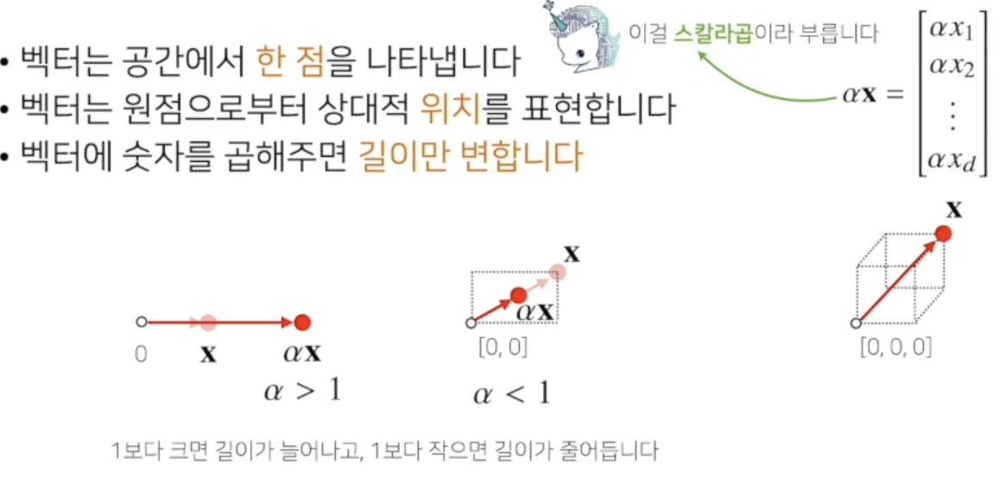

# 벡터

수업일: 2024/05/17
비고: 강의 정리
주차: 4주차 학습내용

벡터는 숫자를 원소로 가지는 리스트(list) 또는 배열(arrasy)

$$
X = \begin{bmatrix}1\\7\\2\end{bmatrix}
$$

$$
X^T=\begin{bmatrix}1,7,2\end{bmatrix}
$$

```python
x = [1, 7, 2]
x = np.array([1, 7, 2])
```

$$
X = \begin{bmatrix}x_1\\x_2\\...\\x_d\end{bmatrix}
$$

$$
X^T=\begin{bmatrix}x_1,x_2, ...,x_d\end{bmatrix}
$$

d는 벡터의 차원을 의미



$$
x = \begin{bmatrix}x_1\\x_2\\...\\x_d\end{bmatrix}
$$

$$
y = \begin{bmatrix}y_1\\y_2\\...\\y_d\end{bmatrix}
$$

$$
x+y = \begin{bmatrix}x_1+y_1\\x_2+y_2\\...\\x_d+y_d\end{bmatrix}
$$

$$
x{\bigodot}y = \begin{bmatrix}x_1y_1\\x_2y_2\\...\\x_dy_d\end{bmatrix}
$$


벡터의 노름(norm)은 원점에서부터의 거리를 의미

$$
X = \begin{bmatrix}x_1\\x_2\\...\\x_d\end{bmatrix}
$$

$$
||x||_1 = \sum_{i=1}^{d}{|x_i|}
$$

```python
def l1_norm(x):
	x_norm = np.abs(x)
	x_norm = np.sum(x_norm)
	return x_norm
```

L1 노름은 각 성분의 변화량의 절댓값을 모두 더한다.

$$
||x||_2 = \sqrt{\sum_{i=1}^{d}{|x_i|^2}}
$$

```python
def l2_norm(x):
	x_norm = x*x
	x_norm = np.sum(x_norm)
	x_norm = np.sqrt(x_norm)
	return x_norm
```

L2 노름은 피타고라스 정리를 이용해 유클리드 거리를 계산한다.


두 벡터 사이의 각도 

$$
cos\theta = \frac{||x||^2_2+||y||^2_2-||x-y||^2_2}{2||x||_2||y||_2}
$$

$$
||x-y||_2=||y-x||_2
$$

$$
cos\theta = \frac{2<x,y>}{2||x||_2||y||2_2}
$$

$$
<x,y> = \sum_{i=1}^dx_iy_i
$$

```python
def angle(x,y) :
	v = np.inner(x,y) / (l2_norm(x) * l2_norm(y))
	theta =  np.arccos(v)
	return theta
```