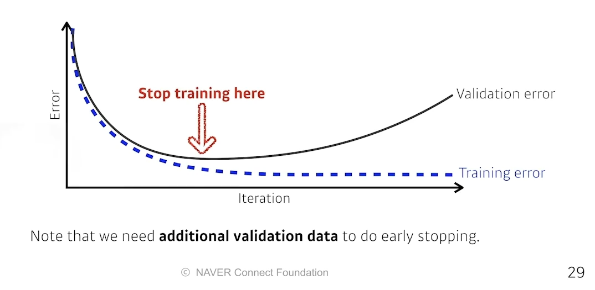

# Regularization

수업일: 2024/05/31
비고: 강의 정리
주차: 6주차 학습내용

- Early stopping
- Parameter norm penalty
- Data augmentation
- Noise roubustness
- Label smoothing
- Dropout
- Batch normalization

**Early stopping**

**Parameter norm penalty**

It adds smoothness to the function space.

→ parameter가 너무 커지지 않도록 하는 것

$$
total \; cost = loss(D;W) + \frac{\alpha}{2}||W||^2_2
$$

$$
Parameter \; Norm \; Penalty = \frac{\alpha}{2}||W||^2_2 
$$

**Data Augmentation**

More data are always welcomed.

However, in most cases, training data are given in advance.

In such cases, we need data augmentation.

데이터의 라벨이 바뀌지 않는 한도 내에서 변경하는 것을 의미.

**Noise Robustness**

Add random noises inputs or weights.

input과 weight에 noise를 넣어줌으로써 정확도가 올라간다는 실험 결과 有

**Label Smoothing**

**Mix-up** constructs augmented training examples by mixing both input and output of two randomly selected training data.

decision boundry를 부드럽게 만드는 효과 

**CutMix** constructs augmented training exammples by mixing inputs with cut and paste and ouputs with soft labels of two randomly selected training data.

성능을 많이 올릴 수 있다.

**Dropout**

In each forward pass, randomly set some neurons to zero.

**Batch Normalization**

Batch normalization compute the empirical mean and variance independently for each dimension (layers) and normalize.

$$
\mu_B = \frac{1}{m}\sum_{i=1}^mx_i
$$

$$
\sigma^2_B = \frac{1}{m}\sum_{i=1}^m(x_i-\mu_B)^2
$$

$$
\hat{x_i} = \frac{x_i-\mu_B}{\sqrt{\sigma_B^2+\epsilon}}
$$

적용하고자 하는 layer의 statistic을 정교화하는 작업

There are different variances of normalizations.

