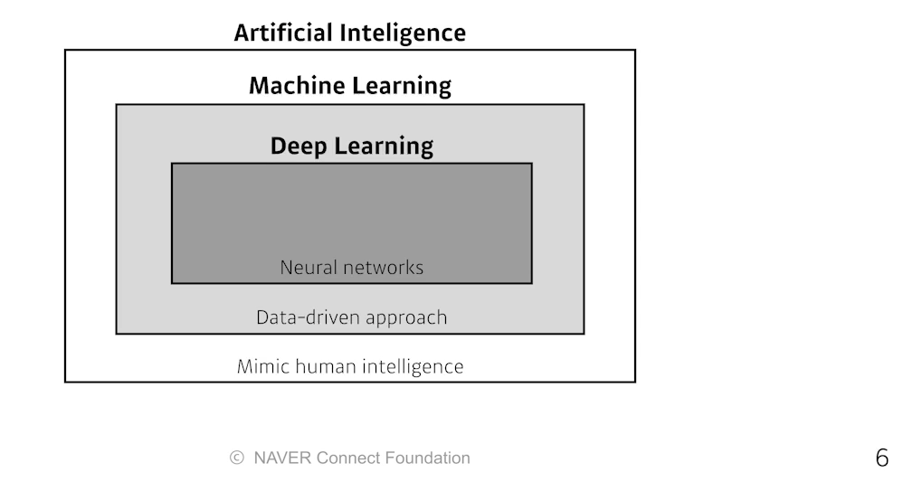

# 딥러닝 기초

수업일: 2024/05/28
비고: 강의 정리
주차: 6주차 학습내용

### Contents

- [ ]  Historical Review
- [ ]  Nerual Networks & Multi-Layer Perceptron
- [ ]  Optimization Methods
- [ ]  Convolutional Neural Networks
- [ ]  Modern CNN
- [ ]  Computer Vision Applications
- [ ]  Recurrent Neural Networks
- [ ]  Transformer
- [ ]  Generative Models Part 1
- [ ]  Generative Models Part 2

---

- Key Components of Deep Learning
    - The **data** that the model can learn from
    - The **model** how to transform the data
    - The **loss** function that quantifies the badness of the model
    - The **algorithm** to adjust the parameters to minimize the loss
    

### Data

Data depend on the type of the problem to solve.

### Model

### Loss

The loss function is a proxy of what we want to achieve.

### Optimization Algorithm

