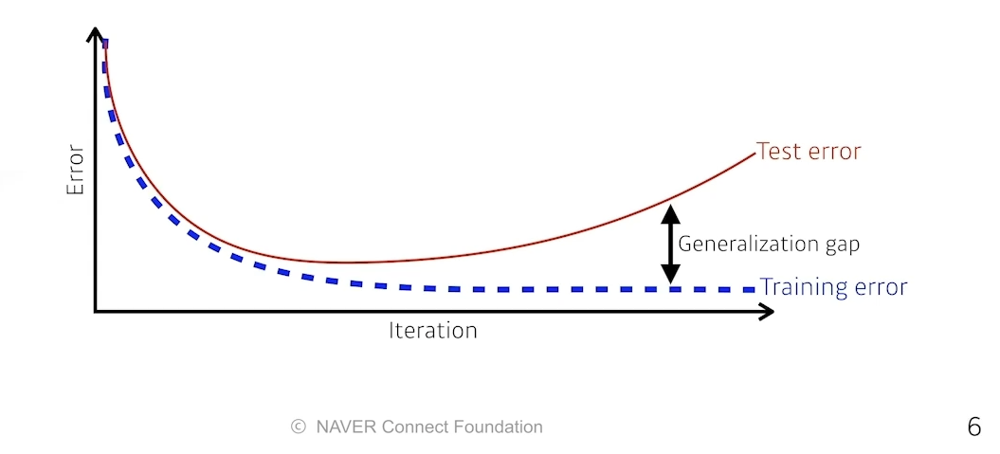

# 최적화

수업일: 2024/05/30
비고: 강의 정리
주차: 6주차 학습내용

### Optimization

- Gradient Descent
    - First-order iterativeoptimization algorithm for finding a local minimum of a differentiable function.
    
    ### Important Conecepts in Optimization
    
    - Generalization
    - Under-fitting vs. over-fitting
    - Cross validation
    - Bias-variance tradeoff
    - Bootstrapping
    - Bagging and boosting
    
    **Generalizaiton**
    
    How well the learned model will begave on unseen data.
    
    
    
    Training data를 잘 설명하는 것도 중요하지만 Test data 또한 잘 설명해야한다.
    
    → Generalization Gap이 크면 안된다.
    
    **Underfitting vs. over-fitting**
    
    
    
    Train data에 대해 작동을 잘 하지만 Test data에 대해 작동 X → Over-fitting
    
    **Cross-validation**
    
    Cross-validation is a model validation technique for assessing how the model will generalize to an independent (test) data set.
    
    
    
    **Bias and Variance**
    
    Low Variance → 어떤 입력을 넣었을 때 얼마나 일관적으로 나오는가를 의미
    
    High Bias → mean(내가 원하고자 하는 값)과 많이 멀어져 있음을 의미
    
    
    
    **Bias and Variance Tradeoff**
    
    $$
    Given \; D = \{(x_i, t_i) \}^N_{i=1}, \; where \; t = f(x) + \epsilon \; and \sim N(0,\sigma^2)
    $$
    
    We can derive that what we are minimizing (**cost**) can be decomposed into three different parts: 
    
    bias, variance, and noise
    
    
    
    Bagging vs. Boosting
    
    - Bagging (**B**oostrapping **agg**regat**ing**)
        - Multiple models are being trained with bootstrapping.
        - ex) base classifiers are fitted on random subset where individual predictions are aggregated (voting or averaging).
        
    - Boosting
        - It focuses on those specific training samples that are hard to classify.
        - A strong model is built bt combining weak learners in sequence where each learner learns from the mistakes of the previous weak learner.
        
    
    