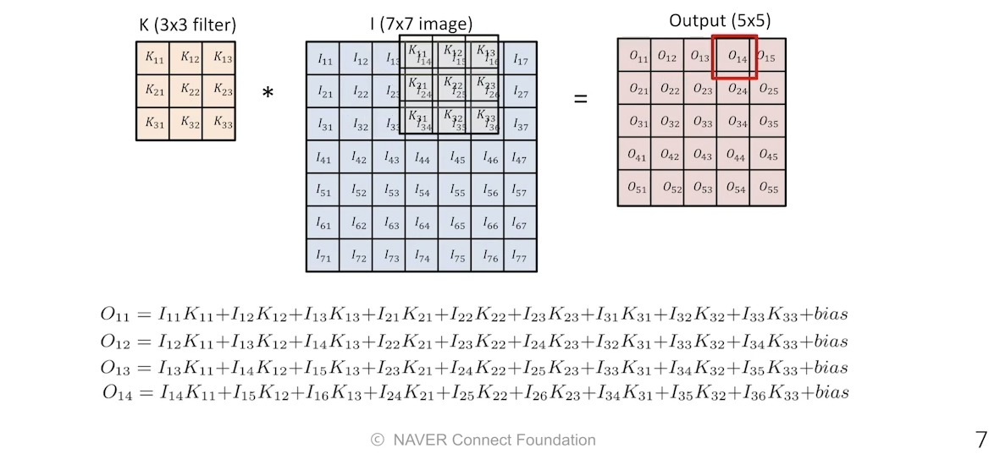

# CNN

수업일: 2024/06/04
비고: 강의 정리
주차: 7주차 학습내용

### Convolution

- Continuous convolution

$$
(f*g)(t) = \int f(\tau)g(t-\tau)d\tau = \int f(t-\tau)g(t)d\tau
$$

- Discrete convolution

$$
(f*g)(t) = \sum_{i=-\infty} ^\infty f(i)g(t-i) = \sum_{i=-\infty}^\infty f(t-i)g(i)
$$

- 2D image convolution

$$
(I*K)(i,j) = \sum_m\sum_n I(m,n)K(i-m, j-n) \\ = \sum_m\sum_n I(i-m, i-n) K(m,n)
$$

Stack of Convolutions

→ 연산에 필요한 혹은 연산을 정의하는데 필요한 parameter의 개수를 잘 생각해야함.

32x32x3 → 28x28x4의 convolutions feature를 얻기 위해서 필요한 parameter의 수는

5x5x3x4 → kernel의 크기 5x5에서 input 채널 숫자 3, output 채널 숫자 4만큼을 곱해준 숫자

28x28x4 → 24x24x10의 경우는 

5x5x4x10

### Convolutional Neural Networks

- CNN consists of convolution layer, pooling layer, and fully connected layer
    - Convolution and pooling layers: feature extraction
    - Fully connected layer: decision making(e.g., classification)

parameter의 숫자가 많을수록 학습이 어렵고 Generalized performace는 떨어지는 경향.

최대한 모델을 deep하게 (convolution layer를 많이 가져가고) 동시에 parameter의 수를 줄이는 방법

Convolution Arithmetic(of GoogLeNet)

### Stride

Stride = 1 : Convolution filter(kernel)을 매 pixel을 돌아가며 찍는 것을 의미

### Padding

**Convolution Arithmetic**

Padding, Stride 수는 parameter 수와 무관

convolution layer

11x11x3x48x2 = 34,848 (35K)

5x5x48x128x2 = 307,200 (307K)

3x3x128x2x192x2 = 884,736 (884K)

3x3x192x192x2 = 663,552 (663K)

3x3x192x128x2 = 442,368 (442K)

dense layer

13x13x128x2x2048x2 = 177,209,344 (177M)

2048x2x2048x2 = 16,777,216 (16M)

2048x2x1000 = 4,096,000 (4M)

### 1x1 Convolution

